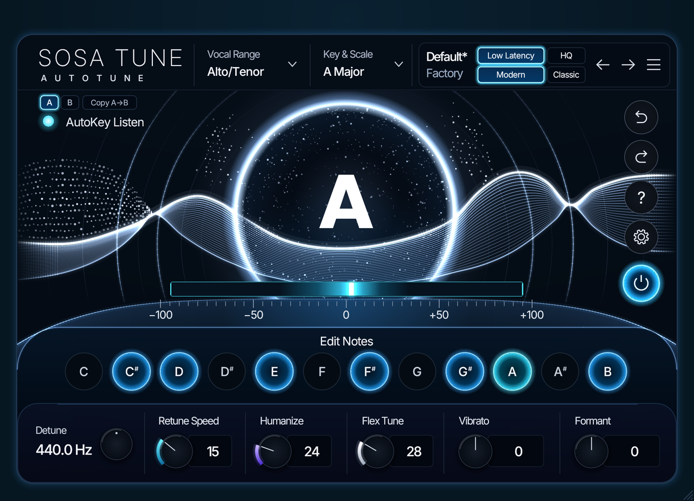
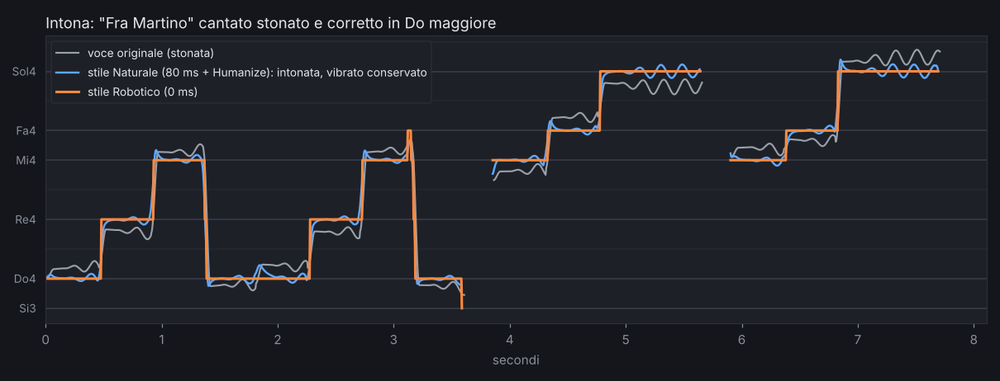

# SosaTune

**Correzione dell'intonazione in tempo reale per la voce**, stile Auto-Tune, scritta in Rust con [nih-plug](https://github.com/robbert-vdh/nih-plug). Funziona come plugin **VST3** e **CLAP** su macOS (e, con gli stessi passaggi, su Windows e Linux).





*Una melodia cantata stonata (grigio) corretta in Do maggiore: in oro lo stile Robotico (velocità 0 ms, l'effetto "alla T-Pain"), in verde acqua lo stile Naturale (velocità 80 ms con Humanize), che porta la voce sulla nota ma conserva il vibrato.*

## Cosa fa

- Riconosce in tempo reale la nota che stai cantando (algoritmo **YIN**).
- La porta sulla nota giusta della **tonalità e scala** scelte: cromatica, maggiore, minore naturale e armonica, pentatoniche, blues, oppure una **scala personalizzata** cliccando sulla tastiera.
- **Velocità di correzione** regolabile: da robotica (0 ms) a naturale (100-400 ms).
- **Humanize**: sulle note lunghe la correzione si ammorbidisce, così le note tenute non suonano "congelate".
- **Flex-Tune**: corregge solo quando la voce è già vicina alla nota; scivolate e note volutamente "sporche" restano tue.
- **Vibrato naturale**: lo riduce o lo aggiunge, anche sopra la correzione robotica.
- **Formanti**: cambia il timbro (la "lunghezza della gola") senza cambiare la nota.
- **Sensibilità** del rilevamento, per voci pulite o con molta aria.
- **Stili pronti**: Naturale, Pop moderno, Robotico, Leggero.
- **Quantità** di correzione e **trasposizione** fino a ±12 semitoni.
- Cambia la nota **senza cambiare il timbro** della voce (pitch shifting **PSOLA**, che conserva le formanti: niente "effetto scoiattolo").
- Tre impostazioni di **voce** (soprano, alto/tenore, voce bassa): le voci acute hanno una latenza più bassa.
- Interfaccia con **indicatore circolare** della nota cantata (scarto in centesimi), manopole, tastiera della scala e **grafico dell'intonazione** in tempo reale.
- Mono e stereo, qualsiasi frequenza di campionamento, latenza comunicata al DAW (che la compensa da solo).

| Voce | Nota più grave | Latenza |
|---|---|---|
| Soprano / voce acuta | 150 Hz (circa Re3) | ~18 ms |
| Alto / Tenore | 90 Hz (circa Fa#2) | ~31 ms |
| Voce bassa | 60 Hz (circa Si1) | ~46 ms |

---

## Installazione sul Mac, passo per passo

Non serve esperienza: basta copiare i comandi nel **Terminale** (lo trovi in Applicazioni → Utility → Terminale). Dopo ogni comando premi Invio.

### 1. Strumenti di sviluppo di Apple

```bash
xcode-select --install
```

Si apre una finestra: scegli **Installa** e aspetta la fine (se dice che sono già installati, va bene così).

### 2. Rust

```bash
curl --proto '=https' --tlsv1.2 -sSf https://sh.rustup.rs | sh
```

Quando chiede, premi **Invio** per l'installazione standard. Poi **chiudi e riapri il Terminale**, e controlla che funzioni:

```bash
cargo --version
```

Deve rispondere con un numero di versione (per esempio `cargo 1.9x.0`).

### 3. Il progetto

Estrai lo zip del progetto, per esempio nella cartella **Documenti**, poi entra nella cartella:

```bash
cd ~/Documents/sosatune
```

### 4. Compila il plugin

```bash
cargo xtask bundle sosatune --release
```

La prima volta ci mette **5-10 minuti**, perché scarica e compila tutte le librerie. Le volte successive basta meno di un minuto. Alla fine trovi i plugin nella cartella `target/bundled/`.

### 5. Installa il plugin

```bash
mkdir -p ~/Library/Audio/Plug-Ins/VST3 ~/Library/Audio/Plug-Ins/CLAP
cp -R target/bundled/SosaTune.vst3 ~/Library/Audio/Plug-Ins/VST3/
cp -R target/bundled/SosaTune.clap ~/Library/Audio/Plug-Ins/CLAP/
```

### 6. Aprilo nel DAW

Apri il tuo DAW, fai ripetere la scansione dei plugin se non compare da solo, e inserisci **SosaTune** come effetto sulla traccia della voce. Lo trovi tra gli effetti di "Vladislav".

- **Ableton Live, FL Studio, Cubase, Studio One, Reaper**: usa il VST3.
- **Bitwig, Reaper**: puoi usare anche il CLAP.
- **Logic Pro e GarageBand** accettano solo il formato AU, che nih-plug non crea direttamente: si può aggiungere con un "wrapper" (vedi *Prossimi passi*).

---

## Come si usa

1. Imposta la **Tonalità** e la **Scala** della canzone (per esempio La minore → Tonalità A, Scala Minore naturale). Se non le conosci, lascia **Cromatica**: ogni nota viene portata al semitono più vicino.
2. Scegli il tipo di **Voce**.
3. Parti da uno **Stile** e poi rifinisci:
   - **Naturale**: velocità 80 ms e Humanize, si sente intonato ma non "corretto";
   - **Pop moderno**: velocità 20 ms, intonazione precisa e brillante;
   - **Robotico**: velocità 0 ms, l'effetto Auto-Tune estremo;
   - **Leggero**: sistema solo le stonature e lascia l'espressione (Flex-Tune alto).
4. I controlli, uno per uno:

| Controllo | Cosa fa | Da dove partire |
|---|---|---|
| Velocità | Quanto in fretta la voce va sulla nota. 0 ms = robotico, 20-80 ms = musicale, 100-400 ms = naturale | 20-80 ms |
| Quantità | Quanta correzione. Sotto il 100% resta un po' dell'intonazione originale | 100% |
| Humanize | Note lunghe corrette più dolcemente, note brevi come prima | 20-40% |
| Flex-Tune | Corregge solo vicino alla nota: 25% lascia stare oltre ~48 centesimi, 100% oltre ~12 | 0% (pop), 50% (espressivo) |
| Vibrato | Negativo lo riduce, positivo lo aggiunge (anche con il robotico) | 0% |
| Formanti | Il timbro: + voce più piccola e chiara, − più grande e scura. La nota non cambia | 0 st |
| Sensibilità | Alzala per voci con molta aria o sussurrate, abbassala se senti salti strani | 30% |
| Trasponi | Sposta tutta la voce di semitoni, mantenendo il timbro | 0 st |

5. Sulla **tastiera** clicca un tasto per escludere o includere una nota (la scala diventa "Personalizzata").

### L'interfaccia

- **Indicatore circolare** (a sinistra): la nota che stai cantando e di quanti **centesimi** sei calante (−) o crescente (+); diventa verde entro ±10 centesimi. Sotto, la nota verso cui viene corretta.
- **Manopole**: trascinale in su o in giù. Tieni premuto **Maiusc** per i ritocchi fini, fai **doppio clic** per tornare al valore iniziale. Passandoci sopra col mouse compare la spiegazione.
- **Selettori** di tonalità, scala e voce: clicca le frecce (o il centro per passare alla scelta successiva).
- **Stili** in alto a destra: si illuminano quando le manopole corrispondono a quello stile.
- **Grafico** in basso: la voce originale in grigio, quella di SosaTune in oro.

---

## Provare il motore senza DAW

Il motore audio (cartella `dsp/`) si può usare anche da solo, su file WAV.

**Demo** con un cantante sintetico stonato (crea `demo_1_originale.wav`, `demo_2_naturale.wav`, `demo_3_robotico.wav`, `demo_4_robotico_vibrato.wav`, `demo_5_formanti.wav`):

```bash
cargo run --release -p sosatune_dsp --example demo
```

**Correggere una tua registrazione** (WAV mono o stereo):

```bash
cargo run --release -p sosatune_dsp --example process -- voce.wav voce_corretta.wav --tonalita La --scala minore --velocita 0
```

Opzioni: `--tonalita` (C, C#, Db... oppure Do, Do#, Reb...), `--scala` (cromatica, maggiore, minore, minore-armonica, pentatonica-maggiore, pentatonica-minore, blues), `--velocita` in ms, `--quantita` in %, `--trasponi` in semitoni, `--voce` (soprano, alto, bassa), `--humanize` e `--flex` in %, `--vibrato` da -100 a 100, `--formanti` in semitoni, `--sensibilita` in %.

**Test automatici** (controllano rilevamento, correzione, qualità e stabilità):

```bash
cargo test -p sosatune_dsp --release
```

---

## Come funziona

```text
voce ──► YIN ──────────► scala ───────────► correttore ─────► PSOLA ──► voce corretta
        "che nota è?"    "nota giusta       "di quanto e       sposta la nota
        (periodo         più vicina"        con che velocità"  mantenendo il timbro
        dell'onda)
```

- **YIN** (`dsp/src/yin.rs`): confronta il segnale con se stesso spostato nel tempo; quando la differenza è minima, lo spostamento è il periodo dell'onda, cioè la nota. Calcolato con la FFT (`dsp/src/fft.rs`) per essere veloce, più un controllo contro gli errori d'ottava.
- **Scale** (`dsp/src/scale.rs`): sceglie la nota ammessa più vicina, con un po' di isteresi per non "tremolare" quando sei a metà tra due note.
- **Correttore** (`dsp/src/corrector.rs`): decide di quanto spostare la nota e con che velocità (un filtro che arriva al bersaglio in "velocità" millisecondi). Qui vivono anche Humanize (la velocità rallenta man mano che la nota dura), Flex-Tune (il peso della correzione cala con la distanza dalla nota) e il vibrato naturale (isolato con un filtro passa-banda centrato su 5,5 Hz, che non lo sfasa e permette quindi anche di toglierlo).
- **PSOLA** (`dsp/src/psola.rs`): taglia la voce in "grani" di due periodi, centrati sugli impulsi delle corde vocali, e li rimette in fila più vicini (nota più acuta) o più lontani (più grave). Ogni grano conserva la risonanza della bocca, quindi il timbro non cambia. Per spostare le formanti, ogni grano viene letto un po' compresso o dilatato nel tempo.

### Qualità misurata

I test (`cargo test -p sosatune_dsp --release`, 29 in tutto) controllano anche la qualità del suono:

- correzione robotica di una melodia: in media **0,3 centesimi** dalla nota giusta; su voci reali circa **2 centesimi**;
- le **formanti** restano entro ~1 dB nelle correzioni tipiche (fino a un paio di semitoni);
- l'**armonicità** della voce (quanto è "pulita", senza ruvidità) in uscita è pari a quella in ingresso, sia su voci sintetiche sia reali;
- vibrato naturale: rimesso con la profondità originale, oppure ridotto del 60-99%.

Limiti noti: le trasposizioni estreme (un'ottava) e le voci molto acute (sopra ~600 Hz) cambiano un po' il timbro, come in ogni pitch shifter di questo tipo.

Il motore non alloca memoria e non usa lock durante l'elaborazione: è sicuro per il tempo reale e usa circa l'1-2% di un core.

## Struttura del progetto

```text
sosatune/
├── dsp/                 il motore audio (nessuna libreria esterna)
│   ├── src/             yin, fft, scale, corrector, psola, synth, wav
│   ├── examples/        demo.rs e process.rs (provare su file WAV)
│   └── tests/           test di robustezza
├── plugin/              il plugin VST3/CLAP
│   └── src/             lib.rs (collegamento al DAW), params.rs (parametri),
│                        editor.rs (interfaccia), shared.rs (dati per il grafico)
├── xtask/               lo strumento che crea i file .vst3 e .clap
└── .github/workflows/   compilazione automatica per Mac su GitHub
```

## Se qualcosa va storto

- **Errore durante la compilazione**: copia tutto il testo dell'errore e mandamelo, lo sistemiamo.
- **`cargo: command not found`**: chiudi e riapri il Terminale dopo aver installato Rust.
- **Il DAW non vede il plugin**: controlla che i file siano nelle cartelle `~/Library/Audio/Plug-Ins/VST3` e `CLAP` e fai ripetere la scansione dei plugin.
- **FL Studio lo segna come "error" nel Plugin Manager**: se succede anche ad altri plugin (FabFilter, Soundtoys...), è la verifica di FL che non funziona su quel Mac. In *Options → Manage plugins* togli la spunta a **Verify plugins**, attiva **Rescan plugins with errors** e premi **Find installed plugins**: SosaTune comparirà nell'elenco degli effetti del Mixer.
- **macOS blocca il plugin** (succede solo se lo copi da un altro computer): `xattr -dr com.apple.quarantine ~/Library/Audio/Plug-Ins/VST3/SosaTune.vst3`
- **Compilarlo senza installare nulla**: se carichi il progetto su GitHub, il file `.github/workflows/build-macos.yml` lo compila da solo; lo zip pronto lo trovi nella scheda *Actions*.

## Prossimi passi

- **Fase 2: editor grafico stile Melodyne.** Il plugin registra la traccia mentre il DAW la riproduce, mostra le note come blocchi su una griglia di pianoforte, e ti permette di trascinarle, correggerle una per una e disegnare l'intonazione. Il motore PSOLA è già pronto per questo: cambia solo da dove arriva la nota bersaglio.
- **Formato AU** per Logic Pro e GarageBand, con [clap-wrapper](https://github.com/free-audio/clap-wrapper).
- Note bersaglio via **MIDI** (suonare la melodia su una tastiera e far seguire la voce) e modalità a **bassa latenza** per il monitoraggio dal vivo.

## Licenza

GPL-3.0-or-later (richiesta dal formato VST3 di nih-plug).

Il carattere dell'interfaccia è **Sora** (© The Sora Project Authors), con licenza SIL Open Font License 1.1: il testo completo è in `plugin/assets/Sora-OFL.txt`.
