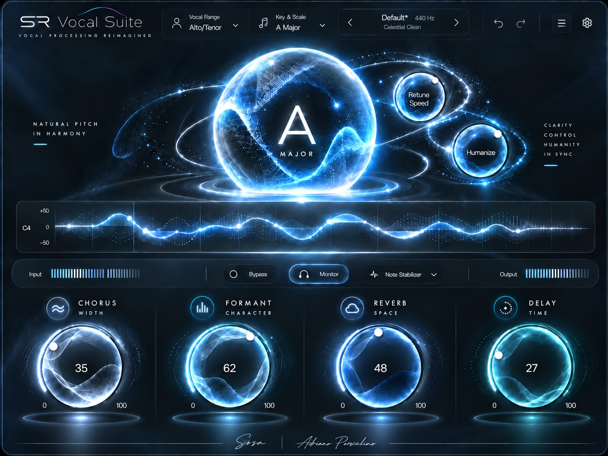

# SR Vocal Suite

Il nuovo autotune di Vladislav: la correzione dell'intonazione di **SosaTune** (stesso motore: YIN, phase vocoder HQ, Low Latency a 0 ms, Humanize, Flex-Tune, formanti) con la grafica "SR Vocal Suite" riprodotta 1:1 e quattro moduli in basso: **Chorus**, **Formant**, **Reverb**, **Delay**.

Formati: VST3, CLAP e Audio Unit (Logic) su Mac, VST3 e CLAP su Windows. Nel DAW: **SR Vocal Suite**, produttore **Vladislav**. Convive con SosaTune (identificativi diversi).



## Comandi

| Dove | Comando | Cosa fa |
|---|---|---|
| In alto | Vocal Range | Soprano, Alto/Tenor, Low Male o Auto (ascolta e sceglie da solo). |
| | Key & Scale (anche clic sulla sfera) | Tonalità, scala, singole note (scala Custom) e AutoKey Listen. |
| | ‹ Default* 440 Hz › | Preset di fabbrica; clic sul nome = lista; clic su "440 Hz" per scrivere l'accordatura. L'asterisco indica che hai modificato il preset. |
| | ↶ ↷ | Annulla e ripeti. |
| | ☰ | Preset, Save as Default, Reset Default, guida rapida. |
| | ⚙ | Tutte le impostazioni (vedi sotto) e misura della finestra. |
| Sfera | A · MAJOR | La tonalità scelta. Respira con la voce. |
| | Retune Speed | Velocità della correzione: 0 ms robotico, 10-30 pop, 50-150 naturale. |
| | Humanize | Note lunghe corrette più dolcemente. |
| Grafico | +50 / 0 / −50 | Scarto della voce dalla nota giusta, in centesimi; a sinistra la nota (es. C4). |
| Barra | Input / Output | Meter di ingresso e uscita. |
| | Bypass | Voce originale, identica e a tempo. |
| | Monitor | Acceso: Low Latency (0 ms, per registrare in cuffia). Spento: HQ (qualità piena per il mix, latenza compensata dal DAW). |
| | Note Stabilizer | Off / Light / Medium / Strong: tiene ferme le note lunghe togliendo vibrato e oscillazioni. |
| Moduli | CHORUS · WIDTH | Chorus BBD del Juno-60 mescolato al chorus a più voci di FL Studio. |
| | FORMANT · CHARACTER | Timbro senza cambiare nota: 50 naturale, 0 voce più grande e scura, 100 più piccola e chiara (±6 semitoni). |
| | REVERB · SPACE | Quanto riverbero. |
| | DELAY · TIME | Quanta eco a nastro (Space Echo RE-201). |

Manopole e sfere: trascina in su/giù (Maiusc = fine) o usa la rotellina; doppio clic = valore iniziale; clic sul numero per scriverlo. L'angolo in basso a destra ridimensiona la finestra.

### Pannello ⚙
- **Correzione**: Amount, Flex-Tune, Vibrato, Transpose, Sensitivity, Tuning, Modern/Classic, Low Latency/HQ.
- **Chorus**: modo I / II / I+II (quelli del Juno-60), miscela Juno ↔ FL, Rate.
- **Reverb**: Decay, Pre-delay, Damping, Low Cut.
- **Delay**: selettore a 12 posizioni come sulla macchina (1-4 solo eco, 5-11 eco + molla, 12 solo molla), Sync (Free o a tempo del DAW), Repeat Rate, Intensity, Bass, Treble, Wow & Flutter, Spring Reverb.
- Output, finestra 75-150%, Save as Default / Reset Default.

## Gli effetti (`dsp/src/fx/`)

- **Chorus** (`chorus.rs`): due BBD in controfase mossi da un LFO triangolare con i valori del Juno-60 (I: 0,513 Hz, II: 0,863 Hz, 1,66-5,35 ms; I+II: 9,75 Hz, 3,3-3,7 ms), filtri anti-aliasing e leggera saturazione, mescolati a un chorus digitale a tre voci per lato (7-20 ms, LFO indipendenti) nello stile del Chorus di FL Studio.
- **Delay** (`space_echo.rs`): nastro con tre testine a distanza 1:2:3, rigenerazione con saturazione del nastro (auto-oscillazione oltre ~85% come la macchina, sempre limitata), perdita sugli acuti e "head bump", toni nel giro, wow & flutter, cambio di velocità che fa scivolare la nota come il nastro vero, riverbero a molla con dispersione. Niente fruscio.
- **Reverb** (`reverb.rs`): FDN a 8 linee con diffusori, smorzamento e modulazione lenta; RT60 misurato nei test.

Catena: correzione → chorus → mandate parallele di delay e reverb (il reverb riceve anche metà dell'eco) → Output.

## Compilare

Su GitHub il workflow `.github/workflows/sr-vocal-suite.yml` (ramo `sr-vocal-suite`) compila tutto, esegue i test, pluginval, il validatore Steinberg e auval, e pubblica nel ramo `sr-vocal-suite-build`:
`SRVocalSuite-Installer-macOS.pkg`, `SRVocalSuite-macOS.zip`, `anteprima.png` e `rapporto.txt`; per Windows nel ramo `sr-vocal-suite-build-win`.

Sul Mac:
```bash
cargo xtask bundle srvocalsuite --release
```

Prove:
```bash
cargo test -p sosatune_dsp --release      # motore + effetti
cargo test -p srvocalsuite --release      # parametri e interfaccia (clic simulati)
cargo run --release -p srvocalsuite --example anteprima -- anteprima.png
cargo run --release -p sosatune_dsp --example fx_demo   # WAV di prova degli effetti
```

## Grafica

`assets/riferimento.jpg` è l'immagine originale. `tools/make_skin.py` toglie le parti che cambiano (valori, numeri, pallini, archi, curva, meter, pulsanti) e crea `assets/skin.png`; il plugin le ridisegna dal vivo negli stessi punti (`src/layout.rs`). Caratteri: Inter e Poppins (SIL Open Font License, testi in `assets/`).
